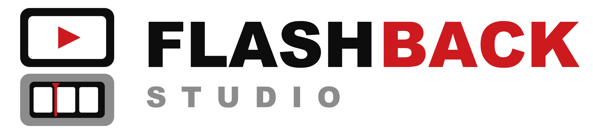

  <picture>
    <source media="(prefers-color-scheme: dark)" srcset="3ds-app/assets/wordmark-dark-2472w.png">
    
  </picture>

Tools for decompressing, converting, viewing and editing `.flb` clips recorded by [Luma3DS-Flashback](https://github.com/LiamTrader43/Luma3DS-Flashback), the 3DS "replay buffer" that keeps the last few seconds of gameplay and saves them on a button press.

`.flb` clips use Flashback's own compressed format, so video players, video editors and other tools (plain ffmpeg included) can't open them. **Use the converter here to turn them into normal videos.**

## What's included

| Tool | Status | What it does |
|---|---|---|
| `convert_flashback.bat` | Available (Windows) | Converts `.flb` clips into MP4 videos |
| Flashback Studio (3DS app) | Available (`.3dsx` or `.cia`) | Plays clips on the 3DS itself, with sound, and trims, renames and compacts them (to about half their size) |

## Converting clips to MP4 (Windows)

### What you need

* **Windows.** The converter uses PowerShell, which comes with Windows. There's no macOS or Linux version yet.
* **[ffmpeg](https://ffmpeg.org/download.html).** Its `bin` folder must be on your PATH: typing `ffmpeg` in a terminal should run it.

### How to use it

1. Download `convert_flashback.bat` from the [latest release](https://github.com/LiamTrader43/Flashback-Studio/releases/latest).
2. Copy your clips from the 3DS SD card (they're in `/luma/flashback/`, named `clip_<date>.flb`) to your PC.
3. Either:
   * **drag** one or more clips onto `convert_flashback.bat`, or
   * put `convert_flashback.bat` in the folder with your clips and **double-click** it to convert all of them.

Each clip becomes an MP4 next to it (`clip_<date>.mp4`): H.264 video at twice the clip's size with sharp, unblurred pixels, at the frame rate it was recorded at, with the game's sound as an AAC track if the clip was recorded with audio. It plays in any video player and imports into video editors like DaVinci Resolve.

Clips that already have an MP4 are skipped, so it's safe to run again on the same folder. Clips compacted by the 3DS app, and clips saved by older Flashback builds (a `.raw` file with a `.txt` next to it), convert the same way.

### If something goes wrong

| Message | What to do |
|---|---|
| `ffmpeg was not found` | Install ffmpeg and add its `bin` folder to PATH, then open a new window and try again. |
| `not a Flashback clip (or the copy is incomplete)`, `not a Flashback clip (file too small)` or `the file ends early` | The file was cut off, usually by removing the SD card or stopping the copy too early, or it isn't a Flashback clip. Copy the clip from the SD card again. |
| `made by a newer Flashback version` | Download `convert_flashback.bat` from the [latest release](https://github.com/LiamTrader43/Flashback-Studio/releases/latest). |
| `... is damaged` or `the clip's frame count doesn't match its index` | The clip file is corrupted. Copy it from the SD card again; if that doesn't help, the recording itself was damaged. |
| `ffmpeg failed` | ffmpeg's own message is shown just above it. The most common cause is a full disk. |
| `its .txt is missing` / `couldn't read the resolution or frame rate from its .txt` | Only for older `.raw` clips: copy the `.txt` with the same name from the SD card next to the `.raw`. |
| `Skipping ...: clip_<date>.mp4 already exists` | Already converted. Delete or rename the MP4 to convert the clip again. |

## Watching clips on the 3DS

Flashback Studio is a homebrew app that lists the clips on your SD card and plays them on the top screen, right on the console.

### Installing it

It comes two ways; use either (or both: they're separate apps).

**As a `.3dsx`, from the Homebrew Launcher:**

1. Download `FlashbackStudio.3dsx` from the [latest release](https://github.com/LiamTrader43/Flashback-Studio/releases/latest) (or build it yourself, see below).
2. Copy it to the `/3ds/` folder on your SD card.
3. Start it from the Homebrew Launcher.

**As a `.cia`, on the HOME Menu:**

1. Download `FlashbackStudio.cia` from the [latest release](https://github.com/LiamTrader43/Flashback-Studio/releases/latest) (or build it yourself, see below).
2. Copy it to your SD card and install it with [FBI](https://github.com/Steveice10/FBI).
3. Start it from the HOME Menu, like any other app.

### Using it

The bottom screen shows the clips in `/luma/flashback/` as a grid, newest first: each one's first frame, with the time it was saved and its length under it. The selected clip's first frame shows full size on the top screen, and its resolution, frame rate, size, whether it has sound, and number of missed frames below the grid. Half resolution clips are shown at twice their size, so they fill the screen.

| Clip list | |
|---|---|
| D-Pad | Select a clip |
| Touch a clip | Select it (touch it again to play it) |
| A | Play the clip |
| X | Delete the clip (asks first) |
| R | Compact the clip (asks first; see below) |
| L | Rename the clip, with the 3DS keyboard (spaces become dashes; names a file can't have, or Windows can't copy, are refused) |
| SELECT | Trim the clip (see below) |
| Y | Refresh the list |
| START | Exit |

| Playing a clip | |
|---|---|
| A | Play/pause |
| Left/Right | Previous/next frame (pauses; hold to repeat) |
| L/R | Back/forward 1 second |
| Up/Down | Speed: 1/4x, 1/2x, 1x, 2x |
| Y | Loop on/off |
| X | Show/hide timing (how long each frame takes to read and draw, and how close the sound is to the picture) |
| Touch the bar | Jump to that point |
| SELECT | Trim (see below) |
| B | Back to the clip list |

Red marks under the progress bar show where the recorder missed frames (they're filled with copies of the frame before, so the clip plays at the right speed). On a missed frame, the player says so.

Clips recorded with audio play their sound at normal speed. It's muted while paused, while stepping through frames, while you touch the bar, and at the other speeds. The player shows which, below the time. The sound needs the DSP firmware dump `/3ds/dspfirm.cdc` on the SD card, like every homebrew app with sound. If you've used one before, you have it; otherwise make it with [DSP1](https://github.com/zoogie/DSP1). Without it, clips play silently.

While a clip plays, the app reads and decodes the next few frames ahead of time, so a slow moment reading the SD card doesn't hold up the picture.

**If playback stutters,** check that Flashback recording is off (Rosalina menu > Flashback recorder). While it's on, it records the app too, and its SD card writes compete with the app reading the clip. X shows how long each frame takes to read and draw, and how many frames were skipped to keep up.

### Trimming clips

Trimming saves part of a clip as a new clip, with its sound; the original is kept. Press SELECT in the clip list (or while a clip plays), find where the part you want starts and press L, then where it ends and press R. The part that will be cut off is darkened on the bar, and the selection plays (and loops) on its own so you can check it. Press X to save it.

| Trimming | |
|---|---|
| L / R | Start / end the selection at this frame |
| A | Play/pause the selection |
| Left/Right | Previous/next frame |
| Up/Down | Forward/back 1 second |
| X | Save the selection as a new clip (asks first) |
| Y | Loop on/off |
| Touch the bar | Jump to that point |
| B or SELECT | Stop trimming |

The new clip is saved next to the original as `<name>-trim.flb` (or `-trim2`, and so on), already compacted, and selected in the list when it's done. Like compacting, it needs free space for the new clip, B cancels it, and nothing is left behind if it fails.

### Compacting clips

A clip is as big as the uncompressed footage (a 60-second full resolution clip with sound is 354 MB), even though its frames are compressed: Flashback saves its recording buffer as-is so saving is instant, and that buffer has room for every frame uncompressed. Compacting rewrites the clip with just its frame data, typically to about half the size (that 354 MB clip became 159 MB). The video is exactly the same, but the clip copies to a PC faster (most noticeable over Wi-Fi) and takes less space.

Select a clip and press R. The details under the list show how big it will be. Compacting a 60-second clip takes about 20 seconds, and B cancels it at any time. When it's done, the app shows the clip's new size and how long compacting took.

* **It needs free space** for the compacted copy (the app checks first): the copy is written next to the clip and only replaces it once it's complete and reads back correctly.
* **The clip is never at risk:** if compacting fails, is cancelled, or the console turns off part way, the clip is left as it was (the app tidies up any leftover files the next time it starts).
* **Compacted clips** play in the app and convert with `convert_flashback.bat` like any other clip, sound included (only the sound the clip's frames last is kept). Use the latest `convert_flashback.bat`: older copies don't know compacted clips.

### Building it

Install [devkitPro](https://devkitpro.org/wiki/Getting_Started) with the 3DS tools (devkitARM and libctru), then run `make` in the `3ds-app` folder. It builds `FlashbackStudio.3dsx`.

`make cia` builds `FlashbackStudio.cia` too. It also needs [bannertool](https://github.com/carstene1ns/3ds-bannertool), which devkitPro doesn't include: put `bannertool` in devkitPro's `tools/bin` folder (next to `makerom`), or run `make cia BANNERTOOL=<path to bannertool>`.

The clip reader (`3ds-app/source/flb.c`) is plain C, so it also builds on a PC.

## The `.flb` clip format

A `.flb` file saved by Flashback (version 1) is its recording buffer saved as-is, which is why the 3DS can save a clip in a few seconds whatever its length:

* **Frames:** RGB565, top row first, each in a fixed-size slot, compressed losslessly with a small QOI-style format (or stored as-is when compression wouldn't make it smaller).
* **Index:** the clip's frames in order, with how many times each one repeats (missed frames are filled with copies of the previous one so clips play at the right speed).
* **Trailer:** the last 48 bytes, starting with the magic `FLBK` and holding the version, resolution, frame rate and frame count.

Version 1 is documented next to `flashbackSaveClipFile` in [`sysmodules/rosalina/source/flashback.c`](https://github.com/LiamTrader43/Luma3DS-Flashback/blob/flashback/sysmodules/rosalina/source/flashback.c) of Luma3DS-Flashback, and the frame compression next to `flashbackCompress`; the decoders in the converter and the 3DS app follow those descriptions.

A compacted clip (version 2) has the same frames back to back, with no unused space, and each index entry gives its frame's position in the file instead of its slot. A clip with audio (version 3, recorded or compacted) also holds the sound, stereo 16-bit at the 3DS's 32,728 Hz, and each frame's position in it. All three versions are described in [`3ds-app/source/flb.h`](3ds-app/source/flb.h).

## License

GPLv3, like Luma3DS-Flashback. See [LICENSE](LICENSE).
