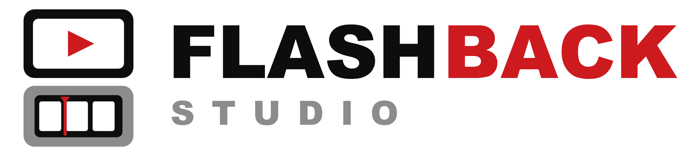

  <picture>
    <source media="(prefers-color-scheme: dark)" srcset="3ds-app/assets/wordmark-dark-2472w.png">
    
  </picture>

  
  

**The companion app for [Luma3DS-Flashback](https://github.com/LiamTrader43/Luma3DS-Flashback).** Watch, trim and share your 3DS clips with their sound and button presses, on the console or on Windows, where it also turns them into MP4 videos.

> **Clips from Flashback v4.0 and newer need Flashback Studio v4.0 or newer.** Video players and editors can't open `.flb` clips, so use Flashback Studio for Windows to turn them into MP4s.

## What you need

* Clips saved by [Luma3DS-Flashback](https://github.com/LiamTrader43/Luma3DS-Flashback). They're in `/luma/flashback/` on your SD card.
* **For the Windows app:** Windows 10 or 11. That's all: it comes with [ffmpeg](https://ffmpeg.org), which makes the videos.
* **For the 3DS app:** the Homebrew Launcher, or [FBI](https://github.com/Steveice10/FBI) to install the `.cia`. For sound, the DSP dump `/3ds/dspfirm.cdc`: if you've used homebrew with sound before, you have it; if not, make it with [DSP1](https://github.com/zoogie/DSP1).

## Installing

**On Windows:**

1. Download `FlashbackStudio-Windows.zip` from the [latest release](https://github.com/LiamTrader43/Flashback-Studio/releases/latest) and extract it anywhere.
2. Open `FlashbackStudio.exe` (keep `ffmpeg.exe` next to it). If Windows says "Windows protected your PC", click **More info**, then **Run anyway**.

**On the 3DS** (either one, or both):

* **Homebrew Launcher:** copy `FlashbackStudio.3dsx` from the [latest release](https://github.com/LiamTrader43/Flashback-Studio/releases/latest) to `/3ds/` on your SD card.
* **HOME Menu:** copy `FlashbackStudio.cia` from the [latest release](https://github.com/LiamTrader43/Flashback-Studio/releases/latest) to your SD card and install it with FBI.

Then, to make a video on Windows:

1. Copy your clips from `/luma/flashback/` on the SD card to your PC, or put the SD card in your PC. The first time, the app opens the SD card's clips by itself; **Open folder** opens any other folder.
2. Click a clip to select it, and click it again to play it.
3. Click **Export** and choose the size. The MP4 is saved next to the clip, and **Show in folder** takes you to it.

On the 3DS, start the app and your clips are on the bottom screen: <kbd>A</kbd> plays one, <kbd>SELECT</kbd> trims it, <kbd>R</kbd> compacts it and <kbd>X</kbd> deletes it.

## Recommended export settings

* **YouTube:** 1440p or 4K, with **Nearest** scaling. YouTube gives bigger uploads a higher quality, which keeps the 3DS's pixels sharp.
* **Discord:** the **Discord** size: 800x480, always under 20 MB (Discord's upload limit without Nitro).
* **A phone:** 800x480 (the starting size), for small files.
* **Video editors:** 1080p, to match the rest of your project.
* **Encoder:** the **GPU** if you have an NVIDIA graphics card. It's faster, with the same picture quality, in slightly bigger files.

The [user guide](docs/user-guide.md) explains every export option.

## FAQ

**Why can't my video player open `.flb` clips?**
They use Flashback's own compressed format. Export them as MP4s with Flashback Studio for Windows.

**Why are clips so big, and what does compacting do?**
Flashback saves its recording buffer as it is, so saving is instant, and that buffer has room for every frame uncompressed. Compacting rewrites a clip with just its frames, usually to about half the size, without changing the video.

**Playback stutters on the 3DS. What can I do?**
Turn Flashback recording off while you watch (Rosalina menu > Flashback recorder). While it's on, it records the app too, and its SD card writes compete with the app reading the clip.

**It says "Made by a newer Flashback version".**
Update Flashback Studio from the [latest release](https://github.com/LiamTrader43/Flashback-Studio/releases/latest).

**Is there a version for Mac or Linux?**
Not yet.

## More information

* **[User guide](docs/user-guide.md):** every button and setting in both apps, trimming, compacting, export options, and what each error message means.
* **[Clip format](docs/clip-format.md):** how `.flb` clips are laid out (technical).
* **For developers:** [building both apps](docs/user-guide.md#building), and [`tests/`](tests) has PC tests that run the apps' own code.

## Support

Questions, or found a bug? Join the [Flashback Discord](https://discord.gg/N3TTXP5WB2), or [open an issue](https://github.com/LiamTrader43/Flashback-Studio/issues). If you'd like to support Flashback, you can on [Ko-fi](https://ko-fi.com/liamtrader).

## License

GPLv3, like Luma3DS-Flashback (see [LICENSE](LICENSE)). The Windows download includes ffmpeg, which has its own license (`ffmpeg-LICENSE.txt` in the zip).
